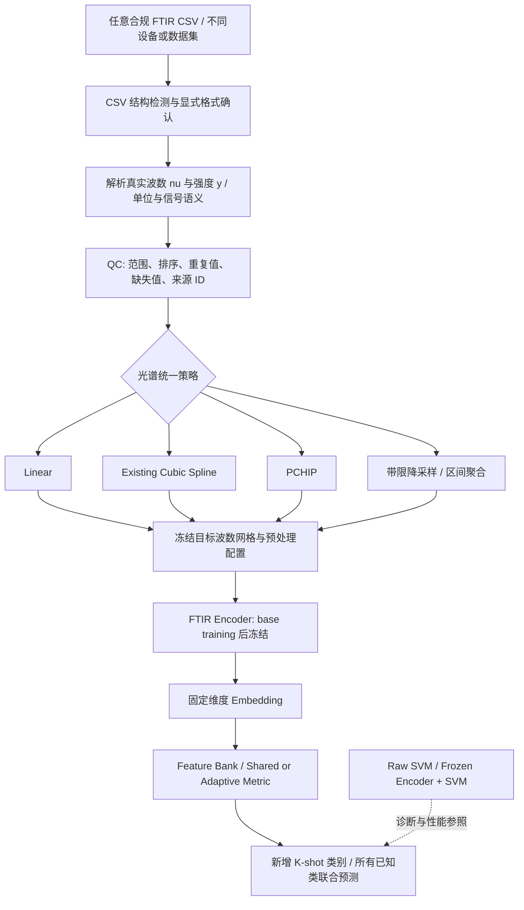
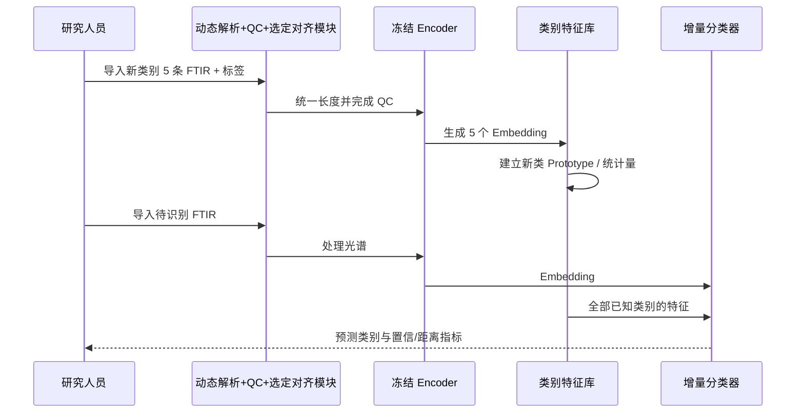

# FTIR 可复用 Encoder 与少样本类别增量学习：详细研究与实施计划

> **英文工作题目**：Reusable Spectral Representation Learning for Few-Shot Class-Incremental FTIR Microplastics Classification  
> **中文工作题目**：面向微塑料 FTIR 识别的统一光谱表示与可复用少样本类别增量分类  
> **版本**：v2.0（2026-10-21，已纳入输入统一方案比较与数据独立性审计）  
> **状态**：研究计划，非实验结论  
> **用途**：指导论文研究、实验实施、代码修改和 Codex 分阶段开发。  
> **修订摘要**：Cubic Spline 从“默认主方法”调整为“必须保留的候选方法”；增加多格式 CSV 动态解析、Linear/PCHIP/带限重采样对照、C4/C8 去重与严格分组协议、方法-网格二维消融与可变长度 Encoder 探索路径。

---

## 0. 执行摘要：先验证输入统一，再优化可复用 Encoder

**研究目标没有改变**：让多来源、多分辨率、格式各异的 FTIR CSV 数据进入同一个可复用模型。Encoder 在 base 阶段训练一次并冻结；遇到新聚合物类别，提供 1/5/10/20 条标记光谱即可扩展类别库，而不用重新训练 Encoder。

**本次 v2.0 的重要修订**：

1. **动态输入解析必须实现，Cubic Spline 不再被预先认定为最佳方案。** 原论文已有的 Cubic Spline 应保留为关键候选，与 Linear、PCHIP、合理的降采样/带限重采样进行同条件比较。
2. **输入兼容性、光谱保真度、分类泛化分开验证。** 能输出同样长度，仅说明接口兼容；插值误差低不一定意味着分类好；分类好也不保证跨设备稳定。
3. **在新训练前审计 C4/C8 样本关系与重复谱。** 保留历史三 seed 结果作为复现基线，新建严格分组评估协议，不偷偷修改旧结果。
4. **先做不改 Encoder 的低成本诊断。** 一方面在当前既定预处理上运行 Frozen Encoder + SVM，判断表征质量；另一方面先用传统 SVM 筛选光谱统一方法和目标网格。两项可并行，但不能将“使用新预处理直接喂旧 Encoder”的结果当作公平判定。
5. **选定输入协议后，才公平地比较新的 Encoder 训练目标。** 若改变预处理策略，须在相同数据预算和 splits 下重新训练相应 Encoder；冻结的老 Encoder 只能配套原训练的输入协议。
6. **研究最终成败不只看是否打败原始谱 SVM。** 同时测量未见类精度、old/new 平衡、跨分辨率/来源、更新速度、存储与可持续复用价值。

**新的推荐执行链**：

> 数据与泄漏审计 → 动态 CSV 接口 → Linear/Cubic/PCHIP/带限重采样对照 → 选择冻结的预处理配置 → Frozen Encoder + SVM 基线诊断（原配置）→ 新 Encoder 训练与评估 → 无梯度类别增量 → C4↔C8 和外部域验证。

其中“Frozen Encoder + SVM 基线诊断”与“输入统一方法筛选”可在完成审计后并行进行；最终新 Encoder 的性能比较必须统一评价协议。

**核心研究问题**：

> 哪一种物理坐标感知的动态 FTIR 输入标准化方式，能在保留聚合物特征峰与分类信息的前提下，支持一个跨分辨率、可冻结的共享 Encoder；从而使未来未见类别仅凭少量标记光谱完成增量接入，而无需为每次加类重新训练网络？

### 0.1 本研究要明确区分的三个概念

| 概念 | 目标 | 必须报告的证据 |
|---|---|---|
| **Input compatibility** | 任意合规 CSV、不同长度/顺序/轴采样都能解析并输出模型需要的接口 | CSV 覆盖率、QC、统一后的长度/波数轴、失败率 |
| **Spectral fidelity** | 尽量保持吸收峰与光谱形状，避免虚假峰或非物理外推 | 重建误差、峰位/峰高/面积变化、保形性、计算耗时 |
| **Downstream generalization** | 训练过的表征在新类别、不同分辨率及外部数据上仍有用 | Accuracy/Macro-F1、跨域差值、old/new/AIA、更新成本 |

三个目标彼此有关，但不能互相替代。

---
## 1. 已有工作、证据与边界

### 1.1 现有研究中已经具备的内容

根据已有论文草稿和当前项目对话，已具备：

- **Cubic Spline Interpolation** 统一 FTIR 波数采样网格的方案。论文草稿已有理论公式及 PET 光谱的插值前后对比图。
- FTIR 预处理方案，包括 **airPLS baseline correction** 与 **max normalization**，草稿还讨论了 **ESMA** 数据增强。
- 基于 Prototypical Networks 的 FTIR 分类流程，以及欧氏距离、共享 Mahalanobis、**Adaptive Mahalanobis** 的实验实现。
- **C4 / C8、1/5/10/20-shot、三个随机 seed** 的当前实验结果，已经在项目内检查 support/query 划分和混淆矩阵计数。
- 原始 FTIR 光谱上的 **SVM** 作为强性能参照。

注意：论文草稿中还写过 **20 次 MCCV 与 70/30 split**，而近期正式 few-shot 结果采用 **3 个 seed**。它们属于不同实验协议，不应混用为同一组统计结论；最终论文必须明确每张表使用的协议。

### 1.2 当前结果：准确率百分比

下表是用户提供的当前实验结果，均为三个 seed 的均值。这里的 **C4 与 C8 是两种光谱分辨率，不是四类和八类**。

| 数据 | Shot | 欧氏 Proto | 共享 Mahalanobis | Adaptive Mahalanobis | 原始光谱 SVM | Adaptive 距离 SVM 差距（百分点） |
|---|---:|---:|---:|---:|---:|---:|
| C4 | 1 | 60.42 | 60.42 | 60.42 | 67.31 | -6.89 |
| C4 | 5 | 66.45 | 79.66 | 77.71 | 86.66 | -8.95 |
| C4 | 10 | 68.39 | 85.07 | 85.26 | 92.22 | -6.96 |
| C4 | 20 | 69.71 | 89.15 | 89.69 | 95.90 | -6.21 |
| C8 | 1 | 62.48 | 62.48 | 62.48 | 72.14 | -9.66 |
| C8 | 5 | 67.98 | 79.63 | 79.65 | 90.65 | -11.00 |
| C8 | 10 | 68.43 | 85.40 | 86.56 | 96.01 | -9.45 |
| C8 | 20 | 68.49 | 90.22 | 91.64 | 98.25 | -6.61 |

**暂时可以支持的判断**：

- Adaptive Mahalanobis 明显好于欧氏 Proto（特别是 5 至 20-shot）。
- 相比共享 Mahalanobis，类别自适应的优势较小且不稳定，C4 5-shot 甚至落后。
- 所有 1-shot 中三种 Proto 结果相同，提示类别独立协方差在 1-shot 下并没有提供额外信息。
- 原始谱 SVM 是目前的强基线，不能用“模型可复用”作为回避比较的理由。
- 现有准确率**尚不能证明**新类别持续加入时的旧类保持、真正的模型冻结复用或跨仪器泛化。

### 1.3 必须正确理解 C4 / C8

FTIR-Plastics 原始论文和数据集说明：

- **C4**：光谱分辨率 4 cm⁻¹；3,000 条光谱。
- **C8**：光谱分辨率 8 cm⁻¹；3,000 条光谱。
- 两者均含六种聚合物：**PET、HDPE、PVC、LDPE、PP、PS**，每种 500 条。
- 数据来自同一研究的 Jasco FTIR 测量体系，不能把 C4→C8 的结果直接描述为跨设备迁移。
- **仪器分辨率（spectral resolution）不等于数据表每两个采样点的实际波数间隔（sampling interval）**；统一网格时需分别记录。

因此，C4/C8 可以承担两项任务：

1. 同一分辨率下的少样本分类诊断。
2. **跨分辨率迁移验证**，例如在 C4 上训练并冻结 Encoder，迁移到 C8 上建立 Prototype；反向也做一次。前提是完成本地样品配对与重复记录审计。

数据文章：[FTIR-Plastics, Data in Brief (2024)](https://pmc.ncbi.nlm.nih.gov/articles/PMC11252596/)；原始仓库：[Zenodo](https://zenodo.org/records/11176740)。

> **泄漏风险**：需要检查 C4/C8 是否存在同一物理样品、重复测量、相近复制谱或共享样品编号。跨分辨率不是天然独立测试集；若能追踪样品 ID，必须按物理样品/批次分组切分，禁止同一样品同时进入训练与测试。若不能验证独立性，应限制相关泛化结论。

---

## 2. 总体方法架构：动态 CSV 解析 + 可选择的光谱对齐 + 冻结 Encoder



**研究型扩展（非第一阶段必做）**：可变长度、波数感知 Encoder 直接使用 `[(ν_i, y_i)]`，再通过位置感知池化输出定长 embedding。它仍需要输入解析、信号语义统一、QC；只是把“固定波数网格”从必经步骤变为可选策略。只有当固定网格方案出现明确瓶颈，才安排这个更复杂的对照。

### 2.1 统一的 CSV 数据契约

每条光谱在任何插值/神经网络处理前，都应形成：

```python
from dataclasses import dataclass, field
import numpy as np

@dataclass
class SpectrumRecord:
    wavenumber_cm1: np.ndarray
    intensity: np.ndarray
    signal_type: str     # absorbance | transmittance_fraction | transmittance_percent
    source_id: str
    spectrum_id: str
    specimen_id: str | None = None
    device_id: str | None = None
    batch_id: str | None = None
    spectral_resolution_cm1: float | None = None
    metadata: dict = field(default_factory=dict)
```

支持的 CSV 布局至少包括：两列竖表（波数, 强度）、多条强度列共用一根波数轴、波数位于首行的宽表；对无明确波数轴或难以可靠判断的格式，应要求用户明确映射，**不得用“列号等于波数”来猜测**。

最终部署模型需要存储不可分割的三件东西：`parser_schema_version + preprocessing_config_hash + encoder_checkpoint_hash`。已有 Prototype 也必须与这套版本一致。

### 2.2 模块职责及是否需要重训

| 模块 | 作用 | 新 CSV 导入时 | 新类别加入时 |
|---|---|---|---|
| CSV Parser + Signal Semantics | 根据波数坐标识别 FTIR 谱 | 动态解析，不训练 | 不训练 |
| Spectrum QC | 拒绝不可信轴、值和超范围数据 | 每条谱检测 | 每条谱检测 |
| Harmonizer | 使用验证后选定的 Linear / Spline / PCHIP / 降采样将谱对齐 | 固定预处理配置，不训练 | 不训练 |
| FTIR Encoder | 得到固定维度 embedding | 用固定权重推理 | 不更新权重/BN 状态 |
| Prototype / Feature Bank | 新增类别均值、可选统计量或邻居 | 不改旧模型 | 仅更新新类支持信息 |
| Batch SVM 对照 | 较强的辨别性能参考 | 按评估协议 | 通常需重新拟合 SVM 分类头 |

### 2.3 不应混淆的物理属性

- **波数轴的采样间隔**不等于仪器的**光谱分辨率**。例如 8 cm⁻¹ 光谱分辨率，不代表 CSV 相邻采样点必相距 8 cm⁻¹。
- 插值只能在已观测值之间估计，不会恢复低分辨率仪器没有测出的信息。
- 即使所有 CSV 最后变成 `L` 个输入值，不同 ATR 测量模式、仪器响应、信噪比、基线和样品制备依然会引入 domain shift。
- 同一 `L` 但不同的波数网格不可被视为相同输入空间。

---
## 3. 工作包 WP0：数据、谱格式、重复样本及代码审计

**优先级：必须先做。此阶段不重训，也不改动旧实验结果。**

### 3.1 当前代码与实验复现审计

- [ ] 找到旧 Encoder 权重、架构、输入长度、embedding 维数、训练数据/类别、模型 hash。
- [ ] 确认历史三 seed、四种 shot 的 support/query 划分，导出逐 episode ID；不能只保存均值。
- [ ] 核对 Raw+SVM 使用的是**真正未经统一化的原生谱**、还是已做统一波数网格/基线校正的谱；命名必须与实际输入一致。
- [ ] 审计训练、验证、测试间的转换次序、增强、标准化、超参数拟合及 class/subject/group 划分。
- [ ] 保存旧代码版本、config、checkpoint 哈希和已有结果的只读快照。
- [ ] 用旧环境复现现有 8 组对照，记录差异，**不要悄悄覆盖旧 CSV**。

### 3.2 CSV 与物理采样信息审计

每个数据集记录：

| 字段 | 检查 |
|---|---|
| `csv_layout` | 两列、多样本宽表、转置表、是否含表头/非数值列 |
| `wavenumber_axis` | 波数起止、升/降序、单位、真实相邻间隔分布 |
| `instrument_resolution` | 若有元数据记录仪器分辨率，不可由样本间隔直接推断 |
| `signal_type` | A、%T、fraction T；单位不明时应报告并停止自动混训 |
| `sample_identity` | specimen/sample/scan/batch/device/file ID 是否可追踪 |
| `quality_flags` | NaN/Inf、重复横坐标、全零、负或无效透过率、异常噪声 |
| `coverage` | 与计划目标公共波数区间是否重叠 |

### 3.3 重点检查 C4 / C8 的数据依赖性

外部 2026 年整合研究 *Xpectrass* 指出 C4 与 C8 来自同一批样品在不同光谱分辨率下的测量，并报告其所使用的 C8 版本中存在 **607 条强度相同、名称不同**的记录。这里**不是断言你的本地文件一定也有 607 条**，而是必须在本地原始文件复核（文献见第 17 节）。

检查层次：

1. **Exact duplicates**：同采样网格、完全相同数组 hash（保留位级记录与数值容差两种检测）。
2. **Metadata-level duplicates**：同物理样品、同一反复扫描、相同/变更文件名的记录。
3. **Near duplicates**：在统一比较网格上观察谱形极端相似的可疑对，人工/元数据确认，不凭相关性一刀切删除。
4. **C4↔C8 pairing**：能否建立跨分辨率 specimen ID 对应关系。若有，模型的严格评估必须按相关样品组划分。
5. **版本差异**：文献去重数与本地数量不同要说明来源/筛选版本，而不是强行使结果吻合。

数据独立性方案：

- 历史随机 split 仅作为 **historical reproduction**。
- 新建 **strict grouped split**：有物理样品 ID 时按样品/批次分组，且结合外部域 holdout；若无稳定 ID，标注独立性无法完全保证，不作强外推结论。
- 同一原谱生成的增强视图**必须处于同一个 group 与 split**。
- 所有插值方法、SVM、Encoder、度量模型共享同一批**合法的 source/support/query 组**。

### 3.4 应交付的文件

```text
outputs/audit/
  code_and_checkpoint_manifest.md
  csv_layouts_and_units.csv
  spectra_qc_report.csv
  duplicate_exact_groups.csv
  duplicate_near_candidates.csv
  c4_c8_pairing_audit.md
  historical_split_manifest.csv
  strict_grouped_split_manifest.csv
  historical_results_unchanged/
  methodology_risks.md
```

**通过标准**：能够逐条追踪输入谱、波数坐标、标签和分组；同一次实验的不同方法看到的是相同分组和同样数量标签；审计发现不能消除的风险被写入报告。

---
## 4. 工作包 WP1：动态 FTIR 输入统一与候选方法消融（核心修订）

### 4.1 研究假设，不预设优胜方法

**H1：** Cubic Spline 可作为不同采样密度谱的可运行统一接口，但不保证最小峰形误差或最强分类效果。

**H2：** 不同对齐方式可能在保峰、抑噪、速度和 few-shot 性能方面存在显著取舍。

**H3：** 统一输入网格过密会把低分辨率谱中的插值数值误认为更丰富的信息；过粗则会损害有用峰特征。

**H4（探索性）：** 波数感知的变长 Encoder 或可减少固定网格引入的失真，但代价是模型设计、训练数据和验证复杂度。

### 4.2 固定的动态 CSV 解析步骤

步骤 1，识别源谱的 `(ν_i, y_i)` 与样本 ID。不能仅通过 CSV 列数决定实际波数坐标。

步骤 2，验证物理单位和信号语义：

- Wavenumber 必须转换成 cm⁻¹；处理上升/下降方向并去除相同坐标。
- 信号必须明确是 Absorbance / Fraction Transmittance / Percent Transmittance。
- 若目标是吸光度，`A = -log10(T)`，%T 先除以 100。只对 `0 < T <= 1` 的合规输入按常规形式转换；超范围值需 QC 和明确策略，不能随意取绝对值。
- 无法判断列含义或单位时返回可追踪错误并要求格式配置。

步骤 3，对原始轴的 NaN/Inf、重复值、超范围、缺测区段和波数覆盖率进行 QC。

步骤 4，在**提前锁定的公共物理波数网格**上执行所选方法，禁止静默超范围外推。公共网格从训练/开发来源的有效覆盖范围确定，测试期不利用标签回选。

步骤 5，实施**同一基线校正/归一化策略**，把预处理顺序、选定方法、目标网格、异常处理和版本写入 config 与 feature-bank metadata。

### 4.3 对齐方法对照矩阵

| ID | 方式 | 含义 | 主要优点 | 假设风险 | 优先级 |
|---|---|---|---|---|---|
| P0 | Native-grid（仅单一兼容来源） | 原数据轴直接分类 | 可衡量统一处理的代价 | 无法直接跨不兼容网格复用 | 必做基线 |
| P1 | Linear Interpolation | 波数坐标上的分段线性估计 | 稳定、快速、可解释 | 峰形可能变钝 | **必做** |
| P2 | **Cubic Spline（现有方法）** | 分段三次插值，注明自然边界或实际代码使用的边界 | 平滑，已有论文和实现 | 过冲/额外极值，边缘敏感 | **必做** |
| P3 | **PCHIP** | 保形分段三次 Hermite 插值 | 避免普通 spline 的局部过冲 | 可能改变尖峰形状，二阶导数不连续 | **必做** |
| P4 | **带限/区间聚合的重采样** | 当目标网格更粗，先适当低通再重采样或按区间积分 | 减少简单抽点的混叠风险 | 过度平滑、损失窄峰 | **必做** |
| P5 | Wave-number-aware variable-length Encoder | 直接输入波数-强度点集合或序列 | 不需固定长度插值 | 训练复杂、表示学习更难 | 研究扩展，非第一轮 |

所有 P1-P4 都可采用相同目标网格（`G1`、`G2`、`G3` 等）做公平比较。**切勿把“Cubic 用更密网格、Linear 用更粗网格”这种不公平对照当成插值算法的胜负。**

### 4.4 目标网格选择也是独立因素

定义：

\[
\mathcal G(\nu_{\min},\nu_{\max},L)
=\left\{\nu_{\min}+j\frac{\nu_{\max}-\nu_{\min}}{L-1}\right\}_{j=0}^{L-1}.
\]

- `νmin/νmax` 是**训练与部署可共同支持的物理区间**，不是数组下标。
- 先统计源域的真实采样间隔、最粗仪器分辨率以及有效峰宽，再在开发集上预定 2 至 3 个候选密度。示意可考虑 `L ∈ {512, 1024, 2048}`，但只是待审计的例子，不能作为未经核实的项目默认值。
- 相同 `L` 必须使用**相同目标物理网格**。
- 对降低网格密度的情形，不允许只取每隔 N 个点作为唯一方法；适当比较抗混叠/面积守恒聚合。
- 仅对覆盖目标区间的谱运行完整模型；不符合条件的谱需 rejection 或单独受控 missing-mask 协议。
- 上采样不会提升仪器真实光学分辨率。C4/C8 的分辨率差异也不能被简单模拟成“每隔一个点抽样”。

### 4.5 数学实现与版本化

现有 Cubic Spline 继续使用原稿分段三次多项式：

\[
S_i(\nu)=a_i+b_i(\nu-\nu_i)+c_i(\nu-\nu_i)^2+d_i(\nu-\nu_i)^3.
\]

但比较时必须显式记录：原稿描述的 `natural boundary` 和**代码实际使用**的边界条件是否一致。`scipy.interpolate.CubicSpline` 默认是 `not-a-knot`，不能不检查就称其为 natural。

实现 API：

```python
record = parse_ftir_csv(path, schema_hint=None)
qc_result = validate_spectrum(record, qc_config)
x_std, metadata = harmonize_spectrum(
    record,
    method=selected_method,  # e.g., "pchip", selected on development data
    target_grid=frozen_grid,
    config=frozen_preprocessing,
)
# deployment: same parser schema / target grid / preprocessing / encoder version
```

### 4.6 光谱保真度实验：不可用插值结果自己当真值

**实验 F1：原始高采样谱的受控稀疏化/缺点重建**

- 在有足够密集采样的原生谱中，预先划定一部分原始测量点作为 `held-out points`；只对保留点拟合插值器，再在 held-out 的**原始真实观测值**位置计算 MAE/RMSE。
- 若只从整条低分辨率谱插值到密网格，不能以新生成的密集光谱为“真值”计算重建误差。
- 受控数值稀疏化只能检验**采样点重建**，不能直接等同于仪器 C4 与 C8 的真实分辨率差异。

**实验 F2：聚合物关键峰的保持程度**

- 记录峰位偏移（cm⁻¹）、峰高差、峰面积相对误差、局部谱形误差、插值过冲率/异常极值比例。
- 关键峰区间及峰检出阈值须在开发数据上预定义；不能为让某一种方法看起来更好而事后改阈值。
- 同时观察基线、噪声、边界处的稳定性；较高的峰形吻合度不意味着较高的分类准确率。

**实验 F3：接口可靠性**

- 多种 CSV 布局、缺少单位、升降序、非等间隔轴、重复波数、缺失值、局部波段缺失、%T/A 输入。
- 输出结构必须固定、可追踪、无越界外推，异常谱不能静默填充正常值。
- 报告处理成功率、运行时间、峰值内存、每种 QC flag 统计。

### 4.7 下游分类选择实验：先 SVM，再 Encoder

**Stage S1：不训练新 Encoder 的快速筛选**

1. 锁定审计后的分组划分及 K-shot 支持集。
2. 对每个 `method × target_grid` 使用完全相同的原谱 ID、波数覆盖范围、baseline/normalization 策略。
3. 用 Raw/Unified Spectrum + SVM，附带 kNN 或 cosine 基线，得到分类性能。
4. 每个超参数（含网格密度和 SVM C/gamma）只能在开发阶段选择，测试集不参与挑选。
5. 筛选 1 至 2 个候选处理策略用于正式 Encoder 训练；**Cubic Spline 保留在最终消融中，即使没有赢**。

**Stage S2：Encoder 端的公平比较**

- 新建 Encoder A（统一策略 A）、Encoder B（统一策略 B），必须同架构、相同可用 base 数据、训练预算、开发/测试划分和评估分类头。
- 如果只把策略 B 的输出直接喂给已按策略 A 训练的冻结 Encoder，这只能作为**对输入扰动的压力测试**，不能证明 B 对 Encoder 训练更差。
- 不允许在同一方法筛选中循环尝试非常多的网格/预处理组合然后只报告最好测试分数。

### 4.8 预先约定的筛选规则

- **Primary**：在锁定的验证集上，优先关注 5-shot、10-shot 的 `Macro-F1`（可同时报告 Accuracy）。
- **Constraints**：不得出现不可接受的峰位失真/虚假峰、静默外推或高 QC 失败率；报告对应数据而非事后设定指标门槛。
- **Secondary**：1-shot、20-shot、保真度、速度、跨分辨率验证差异和处理稳定性。
- 若多方案表现近似，应优先考虑**简单、快速、可重现、跨域稳定**的方案；不能因为 Cubic Spline 是论文原稿就自动优先。
- 保留原始结果及所有候选参数；**最终 test 只在方法与参数冻结后运行一次**。

### 4.9 产物与验收

```text
configs/spectral_grid_candidates.yaml
configs/preprocessing_candidates.yaml
outputs/harmonization/csv_format_test_report.md
outputs/harmonization/qc_and_coverage.csv
outputs/harmonization/reconstruction_metrics.csv
outputs/harmonization/peak_fidelity_metrics.csv
outputs/harmonization/svm_method_grid_comparison.csv
outputs/harmonization/selected_pipeline.yaml
outputs/harmonization/selected_pipeline_decision.md
```

**WP1 通过标准**：每个合规 CSV 能稳定解析并输出统一、带版本的波数网格；明确展示方法与网格对 Accuracy/Macro-F1、保峰、成本的影响，选择一个**经验证但不宣称全局最优**的固定预处理协议。

---
## 5. 工作包 WP2：Frozen Encoder + SVM 表征诊断（与 WP1 可并行）

**目的**：判断当前模型落后于原始谱 SVM，主要来自特征学习还是无训练分类头，而不是预先归咎于 Mahalanobis。

### 5.1 第一轮必须沿用当前 Encoder 的原始输入协议

| ID | 光谱处理方式 | 特征表示 | 分类器 | 目的 |
|---|---|---|---|---|
| D0 | 当前原始谱 SVM **实际使用的**预处理 | 原谱/已处理谱，明确命名 | SVM | 历史强基线 |
| D1 | 同 D0，PCA 只在允许训练数据拟合 | PCA FTIR | SVM | 检验线性降维损失 |
| D2 | 与当前 Encoder **训练时完全一致**的处理 | 冻结 Encoder embedding | SVM | 判断当前表征是否保留 SVM 可用信息 |
| D3 | 与 D2 完全相同 | 冻结 embedding | Shared Mahalanobis | 判断共享度量表现 |
| D4 | 与 D2 完全相同 | 冻结 embedding | Adaptive Mahalanobis | 复核当前方法 |
| D5 | 与 D2 完全相同 | 冻结 embedding | Cosine Prototype / kNN | 检验简单无训练头 |

**不能把刚筛出来的 PCHIP 直接喂原 Cubic Spline 训练出的 Encoder，再将性能下降归咎于 PCHIP。** 这种测试只能称为 preprocessing-shift stress test。

### 5.2 公平协议

- 历史 C4/C8 × 1/5/10/20-shot × 3 seed 用于**历史对照复现**。严格结果另按 WP0 的 grouped/class-disjoint splits 报告，不混成一张表。
- support/query IDs 对所有方法一致；PCA/scaler/SVM 的拟合和超参选择不能使用 query 标签。
- Encoder `eval()`；所有权重与 BatchNorm 统计量冻结；记录哈希验证。
- `Raw+SVM` 与 `Frozen Encoder+SVM` 使用的上游光谱处理应被审计并写清楚。比较表示效果时，可加“同一 harmonization 上的 Raw+SVM”对照。
- 输出每个 episode 的决策、Macro-F1、Accuracy、混淆矩阵、更新时间、推理时间和 embedding dimension。

### 5.3 如何解释结果

| 情形 | 可支持的判断 | 下一步 |
|---|---|---|
| Frozen Encoder+SVM 明显弱于 Raw+SVM | 目前表征/训练协议可能损失判别信息 | WP3 优先改善表征，检查预处理选择 |
| Frozen Encoder+SVM 接近或超过 Raw+SVM，但 Proto 弱 | 分类头或 embedding 几何可能成为瓶颈 | WP4 比较 cosine/kNN/metric/shrinkage |
| 两者表现相近且 Proto 也不错 | 可复用性更值得投入验证 | WP5 与 WP6 |
| 换预处理后老 Encoder 下降 | 可能是预处理分布不一致 | 用**新方案重新训练对应 Encoder**再公平比较 |

这里仍不能仅凭单一分类实验确定“真正原因”，需要将 WP1、WP2 和后续共同证据结合。

### 5.4 输出

```text
outputs/diagnosis/frozen_encoder_vs_raw_svm_per_episode.csv
outputs/diagnosis/feature_diagnostic_report.md
outputs/diagnosis/pipeline_compatibility_matrix.csv
outputs/diagnosis/checkpoint_integrity.json
```

---
## 6. 工作包 WP3：训练真正可复用的 FTIR Encoder

### 6.1 原则

1. **轻量化、可冻结、可部署**优先于盲目堆叠复杂网络。
2. **先冻结经 WP1 筛选的完整输入协议**，包括物理波数网格、对齐方式、信号语义及预处理顺序。要比较不同输入法，需控制 Encoder 架构/训练预算并分别训练匹配的 Encoder，便于归因。
3. 严格区分 base classes、novel classes、验证集和最终测试集。
4. 所有学到的 preprocessing 统计量、网络权重、协方差先验都必须有明确的训练来源。
5. 训练完成后**固定 Encoder 版本**，不针对每个新类别微调；且严禁将新 pipeline 直接替换老 Encoder 的原配处理来推断它的性能。

### 6.2 候选结构（先用简洁模型）

推荐从当前 Encoder 开始，添加一个轻量 **Multi-scale 1D CNN** 作为结构对照，而非立即换大型 Transformer。

示例架构（**候选，不是已验证的最佳配置**）：

```text
Input: unified spectrum [B, 1, L]
  -> Conv1D branch, small receptive field
  -> Conv1D branch, medium receptive field
  -> Conv1D branch, large receptive field
  -> feature concatenation
  -> residual blocks / normalization / dropout
  -> global pooling
  -> projection [B, d], with d in {64, 128, 256}
  -> optional L2 normalization
```

设计理由：FTIR 的判别信息具有局部峰、峰群及较宽的谱段结构，不同感受野可能互补。**这只是模型假设，须通过消融验证**。

### 6.3 训练目标：以简单可归因为先

建议按照如下顺序，而不是一次性叠加所有 Loss：

| 实验 | 训练目标 | 作用 | 结论用途 |
|---|---|---|---|
| E0 | 现有 Encoder + episodic Proto loss | 起点 | 必须复现 |
| E1 | Cross-Entropy（base classes） | 基础监督特征学习 | 判断当前 episodic 训练是否必要 |
| E2 | Supervised Contrastive（SupCon） | 改善类间分离、类内一致性 | 候选核心 |
| E3 | Episodic loss + SupCon | 兼顾判别表征和小样本任务 | 候选核心 |
| E4 | E3 + 物理合理的数据增强 | 提升稳健性 | 必做消融 |
| E5 | 自监督预训练 + E3 | 使用无标签源数据 | **仅数据足够、前几项失败/收益有限时考虑** |
| E6 | E3 + reconstruction loss | 测试是否有利于保峰 | **可选，不能预设有益** |

候选联合损失：

\[
\mathcal L = \mathcal L_{\mathrm{episodic}} +
\lambda_{\mathrm{sup}}\mathcal L_{\mathrm{SupCon}}
+ \lambda_{\mathrm{aux}}\mathcal L_{\mathrm{aux}}
\]

首轮推荐只比较 E0、E1、E2、E3；**不要把带三个 loss 的模型直接定为主方法**。

### 6.4 数据增强原则

源论文草稿讨论过 ESMA；用户此前也研究过 FRDA。输入统一方法是本版新的实验因素，因此增强是在对齐之前还是之后施加，应在 config 中固定并在必要时单独消融；所有基线必须遵循相同的数据使用协议。这里应遵循：

- 数据增强**只作用于训练集**，并在 support/query 分割完成后进行。
- 频谱中的峰位、峰形及化学解释应尽可能保真，避免把不同聚合物的特征峰无物理依据地混合。
- 优先评估轻微 baseline、乘性变化、受控噪声；具体范围从训练数据统计量和验证集确定。
- ESMA、FRDA 可以单独做受控对照，**不得在新类别 few-shot 评估时使用该类别测试 query 来估计增强分布或合成 support**。
- 使用同一个原始谱生成的多个增强视图必须全部留在同一个 split / specimen group 中。
- 如果类条件增强依赖 novel 标签，则必须明确属于 support-only 增强，并和“不增强”做公平比较。

### 6.5 为泛化设计的训练协议

建立两个独立协议，不要把它们混成一份结果：

**协议 P1：普通冻结表征诊断**

- 可以复用当前历史训练好的 Encoder，仅用于判断特征是否有效。
- 不能在未知训练历史时宣称对新类别严格无泄漏。

**协议 P2：严格未见类泛化**

- 事先选择 base classes，仅在这些类上监督训练 Encoder。
- novel classes 在训练 Encoder 时完全不可见，包括 class 标签；如果使用 novel 类无标签谱做自监督，必须另列为 transductive 设定，不与严格 inductive 结果混报。
- 每次新类别到来才揭示该类 K 个 support 标签。
- 测试 query 的标签、分布统计、特征都不能用于梯度训练或拟合支持集参数，除非明确标记为 transductive 实验。

### 6.6 Encoder 检查指标

- Frozen Encoder + Linear SVM / RBF SVM / Cosine Prototype 的 Accuracy、Macro-F1。
- 类间距离与类内距离、Silhouette（仅辅助，不作为最终指标）。
- 未见类 1-shot、5-shot、10-shot、20-shot。
- 随不同分辨率/域变化的特征稳定性。
- Embedding 维数、模型大小、GPU/CPU 推理速度。
- 类别相近（例如 HDPE 与 LDPE）时的混淆分析。

**升级门槛**：在开发集上优于 E0 的某些明确目标，或在近似准确率下显著降低模型复杂度/增量成本。若仅在 base classes 上准确率高、未见类差，则不应晋级。

---

## 7. 工作包 WP4：构建真正无需重训的动态类别分类器

### 7.1 先建立最简单且可靠的基线

对任何 K-shot 类别 \(c\)，令冻结 Encoder 输出为：

\[
z_i = \operatorname{norm}(f_\theta(x_i)),\qquad
\mu_c = \frac{1}{K_c}\sum_{i=1}^{K_c} z_i
\]

基线分类器：

- **Euclidean / Cosine Prototype**：更新类别均值即可。
- **kNN feature memory**：保留少量 support embedding，预测时检索邻居。
- **Shared Mahalanobis**：共享协方差由允许的 base training embeddings 估计并固定。

以上都不需要在新增类别时更新 Encoder 的梯度参数。

### 7.2 保留 Adaptive Mahalanobis：将其做成可增量更新的 Shrinkage Metric

定义共享的基础协方差：

\[
\Sigma_0 = \operatorname{Cov}(Z_{\mathrm{base,train}}) + \epsilon I
\]

对新类 \(c\) 的 K 条 support：

\[
\widehat\Sigma_c = \operatorname{Cov}(Z_{c,\mathrm{support}})
\quad (K>1)
\]

候选自适应协方差：

\[
\widetilde\Sigma_c = (1-\alpha_K)\Sigma_0 + \alpha_K\widehat\Sigma_c + \lambda I
\]

其中

\[
\alpha_K = \frac{K-1}{K-1+\tau}, \qquad \tau > 0
\]

距离：

\[
d_c(z)^2=(z-\mu_c)^\top\widetilde\Sigma_c^{-1}(z-\mu_c)
\]

这一公式是**待验证的改进建议**，不应误写为目前已有代码采用的公式。

优点与限制：

- **K=1 时 \(\alpha_K=0\)**：自动退化为共享度量，避免从一个样本估计独立协方差。
- K 逐渐增大时，可增加类内统计量所占的权重。
- 当 K 远小于 embedding 维数时，类协方差是秩亏的，必须通过 shrinkage / 正则项保持数值稳定。
- \(\tau\)、\(\lambda\)、是否使用协方差体积修正（例如 Gaussian NLL 中的 `logdet` 项）都应**在开发集选择**，不能针对最终测试 query 调整。
- 如果 1-shot 提升是主要目标，**只修改 \(\alpha_K\) 不可能凭空增加单样本协方差信息**；重点仍应是 Encoder、prototype 表征或共享度量。

### 7.3 类增量记忆库（Feature Bank）

建议保存：

```yaml
encoder_version: "frozen_encoder_v1"
preprocessing_version: "selected_harmonization_pipeline_v2"
wavenumber_grid_id: "validated_grid_v2"
harmonizer: "linear_or_cubic_or_pchip_or_bandlimited"  # 实际配置选中一种
embedding_dim: 128   # 示例值；以实际模型配置为准
metric_version: "shared_or_adaptive_mahalanobis_v1"
classes:
  PET:
    count: 5
    prototype: "<fixed-length numeric vector>"
    # Optional: regularized covariance or sufficient statistics
  PP:
    count: 5
    prototype: "<fixed-length numeric vector>"
```

**类更新接口**：

```python
add_class(class_id, support_spectra, metadata)   # new class
update_class(class_id, extra_support, metadata)   # additional support
predict(query_spectra, eligible_class_ids=None)
export_memory(path)
load_memory(path)
```

新增一个类别时：

1. 核验输入是否符合 `grid_config` / `preprocessing_version`。
2. 使用**冻结 Encoder**提取 support embedding。
3. 计算新类均值及允许的统计量。
4. 将该类别写入 Feature Bank。
5. 更新 classifier 的类别索引并测试**所有已知类**。
6. **不调用 `optimizer.step()`，不更新 Encoder / BatchNorm 的训练统计量**。

> 若使用 BatchNorm，增量评估务必设置 `eval()` 并固定 running statistics；否则虽然没有反向传播，也可能悄悄改变 Encoder 的行为。

### 7.4 SVM 的正确定位

SVM 保留两种身份：

- **性能参照**：原始谱 + SVM；冻结 Encoder + SVM。
- **可选部署分支**：若允许每次新增类重新拟合一个小规模 SVM，可换取额外准确率，但应清楚报告与零训练 Prototype 的更新时间差异。

**不能写**“SVM 新增类别天然无需训练”。标准批量 SVM 在类别集合改变后通常需重新拟合决策边界。

---

## 8. 工作包 WP5：少样本类别增量 FSCIL 正式实验

### 8.1 为六类别 C4/C8 设计合理 Session

由于 FTIR-Plastics 只有六类，推荐从下面这个**明确可执行但统计能力有限**的方案开始：

| 阶段 | 类别组成 | Encoder 状态 | 测试范围 |
|---|---|---|---|
| Base Session (S0) | 4 个 base classes | 只在此阶段训练 | 4 个 base classes |
| Incremental S1 | 加入第 5 类（K-shot） | 冻结 | 先前 4 类 + 第 5 类 |
| Incremental S2 | 加入第 6 类（K-shot） | 冻结 | 所有 6 类 |

- 对 `K={1,5,10,20}` 分别运行。
- **多次轮换 base/novel 组合与新增顺序**，避免某一组聚合物难度决定全部结论。
- 同一 K 的各方法共享完全相同的类别划分、support ID、query ID。
- 基础训练与测试的同一类可以来自不同光谱，但要严格分离 specimen / measurement group。
- **S0 的训练不能偷看第 5、第 6 类的有监督数据**。
- 初始 Base Session 的旧类记忆预算必须明确。例如每类保留 5 个 embedding，或保留整个 base 训练集生成的统计量。这两种设定不可混为同一 memory budget。

对只有六个类别的数据集，不应以两个增量 Session 的实验夸大为长期无限增量能力。若能引入草稿中提到的 Kedzierski、Jung、De Frond 数据集，并正确对齐标签，可增加 Session 深度和类别多样性。

### 8.2 核心指标

令 S_t 为第 t 个 Session，\(\mathcal C_t\) 为截至该阶段所有已知类：

\[
A_t = \operatorname{Accuracy}(\mathcal C_t),\quad
A_t^{\mathrm{old}} = \operatorname{Accuracy}(\mathcal C_{t-1}),\quad
A_t^{\mathrm{new}} = \operatorname{Accuracy}(\mathcal C_t\setminus\mathcal C_{t-1})
\]

需要固定评价集并避免不同 Session 测试集构成变化导致混淆：

- **Overall Accuracy**：对截至当前已出现的所有类统一预测。
- **Macro-F1 / Balanced Accuracy**：防止各数据集类别不平衡扭曲结果。
- **Old Accuracy 与 New Accuracy**：观察旧类保留和新类偏置。
- **Average Incremental Accuracy (AIA)**：\(\frac{1}{T+1}\sum_{t=0}^T A_t\)。
- **Forgetting**：对各旧类在历史最佳 Session 与当前 Session 上的准确率下降求均值，定义及受评类别需明确。
- **New/Old confusion ratio**：分析新类被误判为旧类或反向误判的比例。
- **Update time、inference time、memory footprint**：证明持续复用的成本收益。

### 8.3 合格的增量评估

每次 S1 或 S2 加入新类后，使用**同一个类别集合**同时比较：

1. 新类 1/5/10/20-shot；
2. 旧类准确率；
3. 全部已出现类别的整体准确率；
4. 其他模型在相同标签预算下的更新方式；
5. 是否需要重新训练 Encoder、是否需要重新拟合分类头；
6. 更新与推理的时间/资源。

**严重常见错误**：只在新加入的类别之间做 N-way 预测，然后声称实现 class-incremental learning。真正 FSCIL 要和旧类**联合竞争分类**。

---

## 9. 工作包 WP6：跨分辨率、跨数据来源和跨仪器验证

**要分别报告，不要把所有“泛化”合并成一个数。** 所有跨域试验均使用已锁定的光谱统一方案；需要分辨率专用处理时须预先声明并独立报告。

### 9.1 G1：跨分辨率复用（必做）

| 训练 / base embedding 来源 | 测试来源 | 实验名称 | 可支持的结论 |
|---|---|---|---|
| C4 | C4 | In-domain C4 | 同分辨率对照 |
| C8 | C8 | In-domain C8 | 同分辨率对照 |
| C4 | C8 | C4→C8 | **跨分辨率**复用 |
| C8 | C4 | C8→C4 | **跨分辨率**复用 |

至少做以下两种有区别的试验：

- **G1a：同类跨分辨率**。在源分辨率训练 Encoder / 建立固定 Prototype，在目标分辨率直接做相同聚合物识别，衡量 domain shift。若允许目标少量校准样本，必须单独命名为 few-shot domain calibration。
- **G1b：新类 + 分辨率变化联合适应**。Encoder 仅从源数据的 base classes 学习；目标分辨率提供 novel classes 的 K-shot support，评估已出现所有类。旧类特征记忆来自哪一域应固定说明。

**警告**：外部研究报告 C4/C8 共享被测样品来源，而且 C8 存在需要本地验证的重复谱。应以本地样品配对和 group-safe split 为准；同一物理样品若跨训练/测试，不得将此结果视作独立跨域泛化。C4/C8 也未必提供不同设备。

### 9.2 G2：跨数据来源复用（高优先级）

论文草稿中提到的其他来源包括：

- Kedzierski FTIR 光谱（草稿称约 970 条）。
- Jung FTIR 光谱（草稿称约 798 条）。
- De Frond / FLOPP 系列（草稿称约 179 条）。

这些**数量与当前可用版本需在数据审计中复核**，不得把草稿里的计数直接当作新实验实际可用样本数。

候选评估：

```text
Train Encoder: source datasets / base classes only
Freeze Encoder and all preprocessing parameters
Target Dataset: K-shot per eligible class
Evaluate: target query set, no encoder update
Optional: joint old + new classes if taxonomy allows
```

必须建立统一标签词典，例如：

- `PE` 与 `HDPE/LDPE` 不能未经定义直接视为同一颗粒级标签。
- 同名聚合物在不同数据集中可能存在制备和采样差异。
- 需要处理 source-only classes、target-only classes 和标签含糊类别。
- 不能仅按“同名标签”的光谱随机分割，若确需检验来源变化，应按数据来源分组评估。

### 9.3 G3：跨仪器泛化（有独立设备证据才做）

如果元数据能证明来自不同仪器或至少不同采集装置，可构建 leave-one-instrument-out 实验。否则只写“cross-resolution”或“cross-dataset”，**不得擅称 cross-instrument generalization**。

### 9.4 G4：输入质量与实际漂移

建议加入受控扰动压力测试：

- 不同光谱采样间隔；
- 轻微波数轴偏移；
- 噪声或 baseline shift；
- 低质量光谱的异常处理；
- 透过率/吸光度格式差异（在正确物理转换之后）。

这些是**合成稳健性试验**，不能替代真实跨设备实验。

---

## 10. 工作包 WP7：预注册式对照、消融与统计分析

### 10.1 先区分实验类型：避免在同一个表里比较不同数据预算

| 实验类型 | 固定项 | 变化项 | 回答的问题 |
|---|---|---|---|
| **A：统一方法与网格消融** | 同源原谱 ID、split、SVM 标签预算与调参预算 | Linear/Cubic/PCHIP/带限重采样 × 目标网格 | 什么输入协议在保峰和分类上更有效？ |
| **B：Encoder 表征诊断** | 历史 Encoder、历史预处理和固定 episodes | Raw/SVM、Frozen Encoder/SVM、Proto/Metric | 特征层还是分类层损失性能？ |
| **C：新 Encoder 公平训练** | 模型容量/训练预算/base classes/seed/下游头 | 已选输入协议及 Encoder loss/结构 | 哪个组合更适合未见类？ |
| **D：类别增量** | 同一个冻结 Encoder、K、session/class 顺序、feature memory 预算 | Cosine/Euclidean/kNN/Shared/Adaptive/SVM | 是否可免 Encoder 重训加新类别？ |
| **E：跨域与压力测试** | 预先锁定 pipeline、模型与指标 | C4↔C8、外部来源、噪声、峰位偏移 | 复用能力能泛化到什么范围？ |

### 10.2 最低统一输入消融矩阵（必做）

| 编号 | 光谱处理 | 示例网格 | Native/Unified SVM | 峰位/峰高/面积 | Frozen Embedding | 备注 |
|---|---|---|---|---|---|---|
| H0 | Native-grid | Native | ✓ | 原生参考 | 仅适配已有 Encoder 输入时 | 只适用于单一兼容来源 |
| H1 | Linear | G1/G2/G3 | ✓ | ✓ | 新 Encoder 必须匹配该输入协议 | 最低成本基线 |
| H2 | Cubic Spline | G1/G2/G3 | ✓ | ✓ | 同上 | 原论文方法 |
| H3 | PCHIP | G1/G2/G3 | ✓ | ✓ | 同上 | 必做保形方法 |
| H4 | 带限降采样/区间聚合 | 合理的目标粗网格 | ✓ | ✓ | 同上 | 抗混叠候选 |
| H5（探索） | 波数感知可变长度输入 | 不强制固定波数网格 | ✓（可行时） | 不以插值重建为指标 | 新设计的 Encoder | 有数据与时间时 |

*G1/G2/G3 不等于预设固定 cm⁻¹ 分辨率，先经过审计定义。带限策略针对实际降采样，不要求对全部密网格做没有意义的带限。*

### 10.3 模型侧主要对照

| ID | 输入 | 特征 | 分类器 | 类别扩展时 |
|---|---|---|---|---|
| B0 | Native 或原历史 SVM 预处理（准确注明） | 光谱本身 | RBF SVM | 重新拟合头 |
| B1 | Selected Harmonizer | 光谱本身 | RBF SVM | 重新拟合头 |
| B2 | Selected Harmonizer | PCA（训练集拟合） | SVM | 重新拟合头 |
| B3 | 原 Encoder 专属原配置 | Current Frozen Encoder | Euclidean / Cosine Proto | 更新原型 |
| B4 | 原 Encoder 专属原配置 | Current Frozen Encoder | Shared Mahalanobis | 更新原型 |
| B5 | 原 Encoder 专属原配置 | Current Frozen Encoder | Adaptive Mahalanobis | 更新原型/统计量 |
| B6 | 原 Encoder 专属原配置 | Current Frozen Encoder | SVM | 重新拟合头 |
| B7 | Selected Harmonizer | Newly Trained Frozen Encoder | Cosine / kNN | 更新特征库 |
| B8 | Selected Harmonizer | Newly Trained Frozen Encoder | Shared Mahalanobis | 更新原型 |
| B9 | Selected Harmonizer | Newly Trained Frozen Encoder | Adaptive Mahalanobis | 更新原型/统计量 |
| B10 | Selected Harmonizer | Newly Trained Frozen Encoder | SVM | 重新拟合头 |

**关键公平约束**：B3-B6 的预处理保持历史训练配置，B7-B10 使用新配置。如果想单独估计“输入处理”对 Encoder 的收益，就应在同一个 Encoder 架构、训练预算下分别用两个输入配置训练，不能比较两个不同配置但训练过程完全不同的 checkpoint 就宣称某种插值胜利。

### 10.4 Encoder、度量与复用消融

- Encoder：E0/E1/E2/E3/E4（详见第 6 节），其余参数保持不变。
- Metric：Euclidean、Cosine、Shared Mahalanobis、Adaptive Mahalanobis、kNN memory。
- Shot：1/5/10/20；若有足够样本增加更小类预算和更高 shot 边界测试。
- Grid：方法固定时改变 G1/G2/G3；网格固定时改变方法。
- 预处理次序：只有必要时单独做受控消融，例如 baseline/normalization 对不同输入策略的影响。
- Domain：C4→C8 与 C8→C4 分开；相同样品跨域时明确依赖性与 train/test group 隔离。
- 持续性：每个 Session 的 old/new/overall，encoder checkpoint hash 不变，memory/update cost 真实测量。

### 10.5 结果与统计要求

1. **以 episode/group 为单位保存原始数据**，包括可追踪的样本 ID、group ID、prediction、label、score、seed、support IDs、模型与预处理配置 hash。
2. **报告三 seed 的历史结果，但新主张应增加独立 group/class 划分与重复次数**；不能把三 seed 的数值波动当作高度稳定的结论。
3. 用相同划分进行配对比较；对独立 group / dataset 采用合适的置信区间评估，不能把高度依赖的多次查询当成独立试验。
4. 明确 primary endpoint，例如锁定验证协议中的 5/10-shot Macro-F1，以及 FSCIL AIA 和 old/new accuracy。不能根据最终测试结果临时改 primary metric。
5. 若并行比较多个模型/插值配置，报告完整尝试范围、选择规则、多重比较处理与负结果。
6. 测试集仅作最终报告，不用于选 Grid、PCHIP、Encoder loss、SVM C/gamma、Mahalanobis shrinkage 或 QC 阈值。
7. 图表至少包括：方法×网格热图、峰保真与分类散点图、C4/C8 方向矩阵、shot 曲线、Session 旧新类曲线、更新成本与 Accuracy Pareto 图。

---
## 11. 工作包 WP8：真正可持续复用的部署设计

### 11.1 用户操作流程



### 11.2 增量系统验收条款

- [ ] 导入任意一条格式合规、波数覆盖满足要求的 CSV 光谱，动态识别其物理坐标，经过固定的 parser+QC+harmonizer 后输出固定长度与特征维数。
- [ ] 类别索引是动态的，不能把六类名称硬编码进最终分类头。
- [ ] 加入新类后**冻结 Encoder 的全部参数和状态**，记录权重哈希，升级前后完全一致。
- [ ] 不发生反向传播或 optimizer update。
- [ ] 新类别立刻进入候选类别集合，所有旧类也仍参与预测。
- [ ] 支持保存/加载 Feature Bank，并确保同一输入产生可重复预测。
- [ ] 把 Encoder、波数网格、选定插值/重采样策略、信号语义、预处理与 metric 的版本绑定，防止旧 Prototype 和新 Encoder 混用。
- [ ] 报告更新耗时、峰值内存、模型尺寸、support 存储成本。
- [ ] 对域外、低质量、未知类谱提供 `QC` 或 `unknown/reject` 策略；阈值需在开发集校准，不得用测试集挑选。

### 11.3 必须承认的限制

**永不训练**并不现实：严重设备/样品分布漂移、全新化学体系、数据质量改变可能需要重训或校准。论文应该主张的是：

> 在指定的操作范围内，固定 Encoder 可被复用；新类仅通过 K-shot 原型更新完成接入，从而避免每次新增类别都重训完整深度网络。

如果后来决定升级 Encoder，旧 Feature Bank 的 embedding 可能必须统一重算。应将“模型版本升级”和“新增类别”视为两类不同操作。

---

## 12. 更新后的依赖路线图（v2.0）

| 阶段 | 关键任务 | 前置 | 交付 | 进入下一阶段的标准 |
|---|---|---|---|---|
| **P0** | 数据/代码/CSV 格式/泄漏与重复审计 | 当前仓库和数据 | `audit/`、固定 manifests、历史结果快照 | 来源和 split 可追踪，风险显式化 |
| **P1** | 动态 CSV 解析器 + Linear/Cubic/PCHIP/带限对照 | P0 | Parser/QC、方法×网格×SVM/保峰表 | 得到可运行、版本化的候选输入配置 |
| **P2** | 当前 Frozen Encoder + SVM 诊断 | P0；保留历史输入协议 | 表征诊断 | 明确 Encoder 和分类头差距的证据 |
| **P3** | 冻结选择结果，在相同训练预算下比较新 Encoder | P1 + P2 | E0/E1/E2/E3（必要时 E4）checkpoint | 未见类开发协议能支持模型选择 |
| **P4** | Shared/Adaptive Metric + Feature Bank | P3 | 动态加类 API | 免梯度 add/update class + old/new 共同预测 |
| **P5** | FSCIL Session 实验 | P4 | 按 Session 的指标和成本 | 旧/新类联合评估完整 |
| **P6** | C4↔C8 及外部来源泛化 | P5；P0 审计完成 | 域迁移矩阵及失败案例 | 不越过样本独立性与仪器元数据边界 |
| **P7** | 方法/网格/Encoder/Metric 消融与统计 | P1 至 P6 | 论文图表、统计分析 | 关键结论可以归因而非只看最高分 |
| **P8** | 论文撰写与复现包 | P7 | Methods、Results、脚本与配置 | 文字陈述与实验吻合 |

> **可并行**：P1 与 P2 均可在 P0 后开始。P2 **绝不能**以尚未重训匹配输入协议的旧 Encoder 来评判 P1 的新预处理方法好坏。

### 12.1 第一周或第一批 Codex 任务：不要立刻训练新模型

1. 审计本地仓库、原始 CSV、C4/C8 样本 ID、重复与跨来源关系，输出 P0 报告。
2. 原样保存已有 144 组结果及模型权重，不修改或覆盖。
3. 用历史预处理完成 **Frozen Encoder + SVM** 的 P2 快速诊断。
4. 并行建立新 CSV parser/QC，正确解析真实 `wavenumber` 和 `intensity`。
5. 加入 **Linear/Cubic/PCHIP** 三种方法的比较，网格一致。对粗网格增加带限降采样/区间聚合。
6. 先用 **SVM** 衡量输入方法与网格的分类性能，并用保峰/重建指标分析可能的信号失真。
7. 在开发集选择 1 至 2 个候选，并冻结统一输入配置。

### 12.2 第二批：只训练与新输入匹配的 Encoder

8. 采用**同一 Encoder 架构和训练预算**，比较至少一个“历史 Cubic 输入”和一个“开发集选出的输入”，以归因预处理影响。
9. 在选定输入协议上比较 E0/E1/E2/E3，优先验证 unseen-class few-shot，不因 base accuracy 高就选模型。
10. 将 Encoder 冻结并评估 Proto/kNN/Shared/Adaptive/SVM，报告与原始 SVM 的差距。
11. 完成 Feature Bank 与 Session 增量实验，以及跨分辨率/数据来源测试。

### 12.3 停止与决策条件

- 如果 **Linear、PCHIP 与 Cubic 在分类效果上接近**，优先选稳定、轻量且错误行为易管理的实现，而不是为了复杂度而复杂。
- 如果 **某一方法重建误差小但分类更差**，应诚实报告两类指标的冲突，不把信号保真自动等同于分类优势。
- 如果 **某一方法分类更好但产生不可接受的峰形伪影**，不应仅凭 Accuracy 选择。
- 如果 **所有固定网格对不同来源都很脆弱**，再考虑可变长度/波数感知 Encoder；先避免数据泄漏或不一致的 signal semantics。
- 如果 **当前 Frozen Encoder + SVM 落后 Raw SVM**，改表征训练而不是只改 Mahalanobis。
- 如果 **新 Encoder + SVM 强而 Proto 弱**，优先优化增量头及记忆库，不再盲目扩大 Encoder。
- 如果缺少元数据支持真实跨仪器实验，不允许使用“跨仪器成功”作为标题/结论。

---
## 13. 推荐的工程目录（供 Codex 参考，不是当前仓库的真实结构）

```text
ftir_fscil/
  configs/
    datasets.yaml                 # source/labels/sample+device identifiers
    parser_schemas.yaml          # different CSV layouts / coordinate conventions
    spectral_grids.yaml          # frozen candidate and selected physical grids
    harmonization.yaml           # linear|cubic|pchip|bandlimited + boundary choices
    preprocessing.yaml          # baseline, normalization, signal semantics
    encoder.yaml                # architecture and training objectives
    metric.yaml                 # euclidean/shared/adaptive
    experiments.yaml            # grouped manifests, seeds, shots, sessions
  data/
    spectrum_record.py           # wavenumber, signal, IDs, metadata
    csv_parser.py                # supported layouts with explicit schema hints
    quality_control.py          # range, duplicates, QC flags, missing values
    spectral_harmonizer.py      # common interface, multiple methods
    preprocessing.py            # complete physical/ML pipeline
    manifests.py                # source/group/specimen/label mappings
    split_builder.py            # group-safe, class-disjoint episodes
  models/
    existing_encoder_adapter.py
    multiscale_1d_encoder.py
    optional_variable_length_encoder.py
    losses.py
  classifiers/
    prototype.py
    shared_mahalanobis.py
    adaptive_mahalanobis.py
    svm_baselines.py
    feature_bank.py
  experiments/
    audit_dataset_and_splits.py
    evaluate_harmonization.py    # method x grid x fidelity x SVM
    diagnose_frozen_encoder.py   # old preprocessing ONLY
    train_encoder.py
    evaluate_fewshot.py
    evaluate_incremental.py
    evaluate_cross_resolution.py
    evaluate_cross_dataset.py
  evaluation/
    spectral_fidelity.py        # peak position / height / area, held-out RMSE
    metrics.py
    statistics.py
    report_builder.py
  tests/
    test_csv_layouts.py
    test_signal_semantics.py
    test_no_extrapolation.py
    test_harmonization_methods.py
    test_peak_preservation.py
    test_duplicate_and_group_leakage.py
    test_checkpoint_preprocessing_compatibility.py
    test_encoder_is_frozen.py
    test_1shot_fallback.py
    test_incremental_feature_bank.py
  outputs/
    audit/
    harmonization/
    diagnosis/
    encoder_training/
    incremental/
    reports/
```

**实现边界**：Codex 应先扫描现有 FTIR_PrototypicalNetworks 的真实结构并做最小、可回滚的改动。已有 cubic spline 函数和历史结果应被适配复用，而不是为了符合此示意结构而重写所有代码。

---
## 14. Codex 实施 Prompt（按顺序执行，直接可复制）

### Prompt A：数据、CSV 与重复样本审计（**第一步**）

```text
You are working in an existing FTIR microplastics few-shot learning repo.
Do not retrain models or overwrite existing results/checkpoints.

Task: audit the current data and evaluation protocol BEFORE experiments.

1. Inspect the actual files, CSV schemas, existing spline implementation,
   preprocessing order, Encoder checkpoint, SVM and shot/seed protocols.
2. C4 and C8 denote spectral resolutions (4 and 8 cm^-1), not class counts.
   Do not confuse instrument resolution with wavenumber sampling interval.
3. For each dataset, report wavenumber range/spacing, signal type (%T,
   fraction T, absorbance), CSV orientation/layout, classes, file/sample IDs.
4. Identify exact duplicate spectra, suspect near duplicates, repeated
   measurements, and potential C4/C8 physical sample pairing. A 2026
   external analysis reported redundant C8 spectra, but VERIFY this locally
   instead of assuming any specific count.
5. Find and export saved support/query IDs for all historical runs. Check
   class leakage, group leakage, duplicate augmentation and preprocessing
   leakage. Preserve all historical outputs unchanged.
6. Produce BOTH (a) an historical reproduction manifest and (b) a strict
   grouped/class-disjoint evaluation plan whenever metadata supports it.
7. Report explicitly what cannot be confirmed from the available metadata.

Deliver code-and-data audit markdown, source metadata CSV, duplicate group
CSV, split manifests, tests and a list of unresolved risks. No new model
training and no claims of generalization at this stage.
```

### Prompt B：动态 FTIR CSV 解析 + 统一方法和网格消融

```text
Goal: build a robust dynamically reusable FTIR input interface and
experimentally compare harmonization methods. Existing cubic spline is
NOT assumed optimal and MUST be retained as one candidate.

1. Reuse existing code where correct; do not break old experiments.
2. Implement parser(s) for two-column CSV, wide CSV with one common
   wavenumber axis, and transposed data if reliably detectable.
   Accept explicit schema hints; never assume column index equals cm^-1.
3. Record source/specimen/device/batch IDs, actual wavenumber arrays,
   signal semantics, instrument resolution metadata and QC flags.
4. Handle ascending/descending axes, invalid/duplicate coordinates,
   NaN/Inf, incompatible physical range, absorbance vs %T/fraction T.
   Do not silently extrapolate beyond measured spectral ranges.
5. Provide a harmonize_spectrum API with these candidates:
   - linear interpolation;
   - existing cubic spline (record actual boundary conditions);
   - PCHIP shape-preserving interpolation;
   - anti-aliasing/band-limited resampling or area-preserving binning
     for legitimately coarser target grids.
6. Derive 2-3 target physical wavenumber grids from TRAIN/DEV metadata.
   On the same grid compare all relevant methods, using identical
   support/query IDs and equal hyperparameter search budgets.
7. Evaluate (A) held-out original sampling-point reconstruction error,
   (B) peaks: position, height, area and artificial overshoot,
   (C) downstream SVM accuracy + macro-F1 for 1/5/10/20-shot,
   (D) time/memory/QC failures.
8. Never treat upsampled low-resolution outputs as ground truth or
   assume interpolated points restore instrument resolution.
9. Fit preprocessing statistics and select method, grid, and SVM
   hyperparameters using only permitted training/dev information.
   Keep final test labels completely held out during model selection.
10. Do not feed a newly selected preprocessing pipeline to the old
    frozen Encoder and call that a fair comparison of interpolation
    quality. Encoder input compatibility must be explicit.

Save candidate configs, unit tests, per-spectrum spectral fidelity CSV,
method x grid x SVM results, a decision report, and selected frozen
preprocessing config with content hash. No new Encoder training yet.
```

### Prompt C：冻结现有 Encoder + SVM 诊断（可与 Prompt B 并行）

```text
Diagnose whether the CURRENT trained FTIR Encoder or the metric head
causes the classification gap relative to the current raw-spectrum SVM.

1. Use exactly the input preprocessing originally used to train the
   current Encoder. Verify compatible signal representation and grid.
2. Load the stored Encoder, set eval(), freeze all parameters/buffers,
   export support/query embeddings for the exact historical episode IDs.
3. Compare raw-spectrum SVM, frozen embedding SVM, shared Mahalanobis,
   adaptive Mahalanobis, and simple cosine/kNN baselines.
4. SVM/PCA/scaler parameters must be fitted only on allowed training or
   episode support data. No query labels or new favorable data splits.
5. Keep the old checkpoints/results unchanged. Save checkpoint hashes.
6. Explain any mismatch in upstream preprocessing between the raw SVM
   baseline and Encoder, using an additional matched-input SVM if needed.
7. Deliver per-episode CSV, mean/std/Macro-F1 and Markdown diagnosis.

Do not decide that PCHIP or Cubic Spline is better by feeding one into
an Encoder trained on the other preprocessing pipeline. This is an
out-of-distribution stress test, not a controlled training comparison.
```

### Prompt D：在已选输入协议上训练可迁移 Encoder

```text
After input harmonization ablations and Encoder diagnostics are done:

1. Freeze parser schema, physical target grid and preprocessing version.
2. For a preprocessing ablation, retrain the SAME Encoder architecture
   under equal base-class data, random seeds, optimization budgets and
   evaluation splits; compare legacy cubic spline vs selected method.
3. Compare existing episodic loss (E0), cross-entropy (E1), supervised
   contrastive (E2), and episodic+SupCon (E3) with a controlled baseline.
4. Train on base classes only for strict inductive FSCIL; hold novel
   classes out of supervised Encoder training and model selection.
5. Evaluate unseen-class 1/5/10/20-shot with cosine prototype and SVM
   on frozen embeddings; include C4/C8 resolution shifts and QC flags.
6. Do not optimize the final locked test set. Record exact configs,
   model/preprocessing hashes, memory/time, and all failed runs.

Output reproducible checkpoints, method/training objective ablations,
validation rationale, and a report distinguishing source-known vs novel
class performance. Never claim a universally optimal harmonizer.
```

### Prompt E：真正无 Encoder 重训的 FSCIL 类别扩展

```text
Implement few-shot class-incremental FTIR classification with a frozen
Encoder and versioned Feature Bank.

- Use 4 of 6 polymers as base classes; reserve 2 as unseen novel classes.
- Session 1 adds novel class #1, Session 2 adds novel class #2.
- Run K=1/5/10/20; rotate class splits and addition order.
- Evaluate ALL observed classes jointly at every session.
- Compare cosine/euclidean prototypes, kNN memory, shared and adaptive
  Mahalanobis, plus frozen-embedding SVM which may refit its classifier.
- Enforce the same label and memory budgets and use group-safe splits.
- Encoder weights, buffers, grid and preprocessing must remain unchanged;
  test and log checkpoint/config hashes before and after every session.
- Save old/new/overall accuracy, Macro-F1, AIA, forgetting, update time,
  inference time and feature bank size for every session.
- Add tests for serialization, version mismatch and K=1 fallback.

Preserve historical artifacts; create versioned new outputs/reports.
```

### Prompt F（可选）：不插值的波数感知变长 Encoder

```text
OPTIONAL exploratory research only after fixed-grid baselines finish.
Create a wavelength/wavenumber-aware variable-length spectral Encoder
that reads ordered (wavenumber_cm1, intensity) pairs plus a validity
mask, without first enforcing one fixed interpolation grid.

Use a physically meaningful continuous position representation and
length-agnostic pooling. Control architecture complexity, training
labels, compute budget and evaluation splits against the selected
fixed-grid 1D CNN baseline. Report whether any gain comes from avoiding
interpolation or simply using more parameters. Retain the same CSV QC
and %T/absorbance semantics. If the implementation cannot be validated,
mark the experiment as incomplete and do not make improvement claims.
```

---
## 15. 更新后的论文定位、标题与候选贡献

### 15.1 推荐论文题目（暂定）

**Reusable Spectral Representation Learning with Validated Harmonization for Few-Shot Class-Incremental FTIR Microplastics Classification**

中文：**融合可验证光谱统一方法与可复用特征学习的 FTIR 微塑料少样本类别增量分类**。

若结果显示 Cubic Spline 并非最佳，不应在论文标题中将其写成新颖且普遍优越的步骤；原论文已有 Cubic Spline 仍可以作为重要候选基线和方法学分析对象。

### 15.2 论文建议结构

1. **Introduction**：不同 FTIR CSV 波数轴/分辨率导致输入不可复用，类别标注少，新类持续到来。
2. **Related Work**：光谱插值/保形重采样、FTIR 模型迁移、SVM、ProtoNet、Metric/FSCIL。
3. **Data & Integrity**：原始 C4/C8、额外来源、数据元信息与去重、historical 与 strict group splits。
4. **Dynamic Spectrum Harmonization**：波数与信号统一，Linear/Cubic/PCHIP/带限候选，固定网格与 QC。
5. **Reusable Encoder & Incremental Classifier**：训练目标、冻结 Embedding、Feature Bank 和 Adaptive Mahalanobis。
6. **Experimental Protocol**：方法×网格消融、Encoder/SVM 诊断、unseen-class、增量 sessions、跨域。
7. **Results**：峰保真与分类性能双指标、Accuracy/Macro-F1、old/new/forgetting、更新时间。
8. **Discussion**：为什么原始 SVM 强、输入对齐何时有效、哪些跨域声称有数据支持、持续复用限制。
9. **Conclusion**：以严格实验得出范围限定的贡献，不夸大永久冻结或跨所有仪器有效。

### 15.3 候选研究贡献（全部需以最终实验支持）

**Contribution 1，实验与工程方法**：一个可靠的动态 FTIR CSV 物理坐标解析与光谱统一框架，系统对比传统 spline、保形插值、线性和重采样在光谱保真/分类中的取舍。**不是声称发明 PCHIP/Cubic 等既有数学算法**。

**Contribution 2，表征学习**：训练并检验一个跨不同 FTIR 分辨率及未见聚合物类别可冻结复用的 Encoder；如果联合目标/网络结构没有实测收益，则不能将其作为新算法贡献。

**Contribution 3，类别增量分类**：结合已有 Adaptive Mahalanobis 的 shot-aware / shared covariance 机制和持久类特征库，实现无需 Encoder 重训、但可持续加入新类的分类接口，同时量化旧类保持与更新成本。对于分类头是否完全免训练须据实际实现说明。

**Contribution 4，基准与评估**：使用样本关系审计、group-safe split、多分辨率/跨来源区分、持续 Session 指标形成可复现实验，报告对 SVM 的真实性能差距与复用收益。

### 15.4 三种可能的结果都可诚实解释

| 结果 | 合理论文主张 | 不应声称 |
|---|---|---|
| 某种插值优于 Cubic | 验证了输入策略选择的重要性 | 该插值对所有 FTIR 数据都是最佳 |
| Cubic 最终仍最好 | 现有方法在这些协议/数据上得到定量支持 | Cubic 自然具有跨设备域不变性 |
| 各插值准确率接近，但可复用框架有效 | 成本与稳定性权衡可构成部署价值 | 输入统一本身等于 novel-class 泛化 |

---
## 16. 风险清单与最低防护

| 风险 | 对结果的影响 | 防护或验收 |
|---|---|---|
| C4/C8 同源、重复扫描、C8 存在外部报告的重复记录 | 交叉实验可能因样本重用而偏高 | 本地复核并建立 sample/group manifest，旧/新协议分开 |
| CSV 列顺序/方向/单位识别错误 | 相同维数但物理坐标错位 | 显式波数轴验证、schema hint 和单测 |
| 把 4/8 cm⁻¹ 光谱分辨率等同采样间隔 | 目标网格设计不合理 | 分开记录 `spectral_resolution` 与 `sampling_interval` |
| Cubic Spline 过冲、边界条件与草稿不同 | 产生虚假峰、复现差异 | 记录实际 `bc_type`，峰保真和过冲实验 |
| 从 C8 上采样后当作更高分辨率新测量 | 不实物理结论 | 明确不恢复仪器分辨率 |
| 粗网格直接取点造成混叠 | 谱信息损失 | 带限或面积守恒方法作公平对照 |
| 各插值方法使用不同网格、不同 splits | 不公平结果 | 相同目标物理网格、同一 group splits 和 SVM 预算 |
| 仅报告光谱 RMSE 最小 | 无法证明分类优势 | 两类指标独立报告，预先选 primary endpoint |
| 新处理喂旧 Encoder 后误判插值优劣 | 输入分布不兼容 | 旧 Encoder 用旧协议，新输入需等预算重新训练 |
| %T 与 A 混合或无效值转换 | 光谱形状严重错误 | 显式信号语义与 QC，保留转换记录 |
| 不同来源波数覆盖范围不一致 | 静默外推/缺失值假信息 | 共同有效区间或单独 mask/reject 策略 |
| source/novel 类或 support/query 泄漏 | 夸大泛化 | class-disjoint、group-safe tests、增强组绑定 |
| Encoder BatchNorm 在 add_class 时更新 | 违反冻结复用 | `eval()` + 参数与 buffer 哈希 |
| 1-shot 无法估类独立协方差 | Mahalanobis 数值不稳定 | shared fallback 与 shrinkage |
| SVM 与 Proto 的标签/记忆预算不同 | 比较不公 | 统一 support 数量和 memory 约定，分别报告头更新时间 |
| 只看新类不看旧类 | 不能证明 FSCIL | Session 的 old/new/full + forgetting |
| 把跨分辨率写成跨设备 | 证据越界 | 设备不同必须有 instrument 元数据 |
| 过多方法在测试集筛选 | 模型选择偏差 | dev 上选 config，锁定 test 并完整披露尝试范围 |
| “永不需要重训” | 与实际漂移不符 | 声明适用范围，报告 QC/OOD 与版本升级策略 |

---
## 17. 外部依据、原稿基础与需复核事项

### 17.1 已有论文草稿（项目本地来源）

当前初稿已经包括：**Cubic Spline Interpolation** 的数学公式与 PET 光谱示意、**airPLS** 基线校正、**max normalization**、**ESMA** 数据增强，以及 **Adaptive Mahalanobis Prototypical Networks** 的研究目标。本计划将其视为**已有研究基础**，但不把草稿中的定性描述当作独立验证后的最优性能结论。

### 17.2 可核验的外部参考

1. **SciPy `PchipInterpolator`**：PCHIP 属保形分段三次插值，在单调区段可避免过冲，但不代表其在 FTIR 分类上天然优于 Cubic。https://docs.scipy.org/doc/scipy/reference/generated/scipy.interpolate.PchipInterpolator.html
2. **SciPy `CubicSpline`**：边界条件 `natural` 和默认的 `not-a-knot` 不同；应复核论文方法与代码实现一致性。https://docs.scipy.org/doc/scipy/reference/generated/scipy.interpolate.CubicSpline.html
3. **Villegas-Camacho et al. (2024)**：FTIR-Plastics C4/C8 数据与分辨率说明。https://pmc.ncbi.nlm.nih.gov/articles/PMC11252596/ 及 https://zenodo.org/records/11176740
4. **Xpectrass (2026), RSC Digital Discovery**：报告 C4/C8 来自相同样品的不同分辨率测量，并报告分析版本中 C8 607 条完全相同强度的谱。其结论**须通过本地文件版本重新核查**。https://doi.org/10.1039/D6DD00137H
5. **Snell et al. (2017)**：Prototypical Networks。https://arxiv.org/abs/1703.05175
6. **Khosla et al. (2020)**：Supervised Contrastive Learning。https://proceedings.neurips.cc/paper/2020/hash/d89a66c7c80a29b1bdbab0f2a1a94af8-Abstract.html
7. **Wang et al. (2023)**：Few-Shot Class-Incremental Learning via Training-Free Prototype Calibration (TEEN)。https://papers.neurips.cc/paper_files/paper/2023/hash/30dfe47a3ccbee68cffa0c19ccb1bc00-Abstract-Conference.html
8. **已有 FTIR 文献基础**：原稿使用 Renner et al. (2019) 的预处理讨论、Zhang et al. (2010) 的 airPLS、Yan et al. (2022) 的集成微塑料分类以及 Yan et al. (2023) 的 FRDA。论文成稿时应从原稿参考文献逐一核对引用。

**关于样品独立性的重要提示**：外部研究所述“C4 与 C8 样品关联”与“607 份重复光谱”是文献报告，不自动等同于你本地 CSV 的实际情况。先审计再决定是否剔除以及如何重设 split。

---
## 18. 更新后的验收清单与论文问题

### 18.1 必做：输入统一与数据有效性

- [ ] 原历史 C4/C8 结果和 checkpoint 已只读保存，可复现。
- [ ] 原始 CSV 结构、真实波数轴、signal semantics 与分辨率/采样间隔区分清楚。
- [ ] 按样本/组审计 C4/C8 exact/near duplicates 和跨分辨率关联，保留审计报告。
- [ ] 动态解析至少两列竖表和共用横轴的多谱宽表；非可靠格式提供显式 schema 配置。
- [ ] Linear、**已有 Cubic Spline**、**PCHIP**、合理的粗网格带限处理均已实现并具有测试。
- [ ] 使用相同目标网格对比峰保真、held-out 点重建、1/5/10/20-shot SVM 性能与成本。
- [ ] 最优候选方案通过开发集选出，已锁定 `grid + harmonizer + signal semantics + preprocessing` 配置，并非依据最终测试集挑选。

### 18.2 必做：Encoder 与类别增量

- [ ] 在**原历史预处理**上完成 Frozen Encoder + SVM 诊断；不把换输入造成的下降误解成 Encoder/插值缺陷。
- [ ] 在匹配的新输入协议上重新训练至少一个 Encoder；有需要时以相同架构和预算对比历史 Cubic 方案。
- [ ] 新 Encoder 对严格 unseen classes 1/5/10/20-shot 有实测分析。
- [ ] 用 Feature Bank 实现无需梯度更新的 add/update class，测试权重+BN 状态哈希不变。
- [ ] 每个 FSCIL Session 联合评估新旧类别，输出 AIA/Forgetting/成本。
- [ ] C4↔C8 双向跨分辨率复用已完成，并报告 C4/C8 样本关联的解释限制。
- [ ] 有来源独立的外部数据时，报告跨来源；无真实设备 ID 时不声称跨仪器。

### 18.3 可选扩展

- [ ] 变长波数感知 Encoder，与相同训练数据及预算的固定网格 Encoder 对照。
- [ ] 更丰富的聚合物类别与长 Session 序列。
- [ ] TEEN-style 原型校准、OOD/reject 机制、跨仪器真实测试。

### 18.4 论文最终必须回答的六个问题

1. **不同来源 CSV 如何被可靠识别为真实波数-强度数据？** 各格式的输入兼容覆盖率和 QC 如何？
2. **Cubic Spline、Linear、PCHIP、合理的降采样哪个更合适？** 区分峰保真、分类和成本指标，不预设唯一最优。
3. **Raw SVM 为什么比当前 Adaptive Mahalanobis 强？** 主要是表征损失还是分类决策机制？
4. **统一输入之后，什么 Encoder 训练策略更适于未见类别和分辨率变化？** 是否有严格不泄漏证据？
5. **新类别能否用 K-shot 直接加入，且保持旧类性能？** 是否无需更新 Encoder 状态？
6. **复用方案到底节省多少训练/维护成本，承担多大准确率代价？** 适用边界在哪里？

---
## 最终研究决策（v2.0）

**不删除 Cubic Spline，也不预设它最好。** 原方法保留为必做基线；新增 Linear、PCHIP 与合理的带限/区间重采样对照，并把**目标波数网格**列为独立实验变量。只有在严格分组、相同物理网格和测试隔离条件下，才能判断它们在峰保真、分类与速度上的权衡。

**不立即换一个很复杂的 Encoder。** 先完成当前 Encoder+SVM 的旧协议诊断，同时完成统一输入消融。新输入确定后，以匹配的处理协议重新训练并冻结候选 Encoder。

**持续可用是最终目标，而不是一次性最高准确率。** 严格展示少样本新类别加入时的旧类性能、跨分辨率和外部来源适用范围、版本兼容性以及不重训 Encoder 的更新成本。即使不能全面超过原始谱 SVM，只要复用优势得到定量证实，仍有可检验的研究价值。
