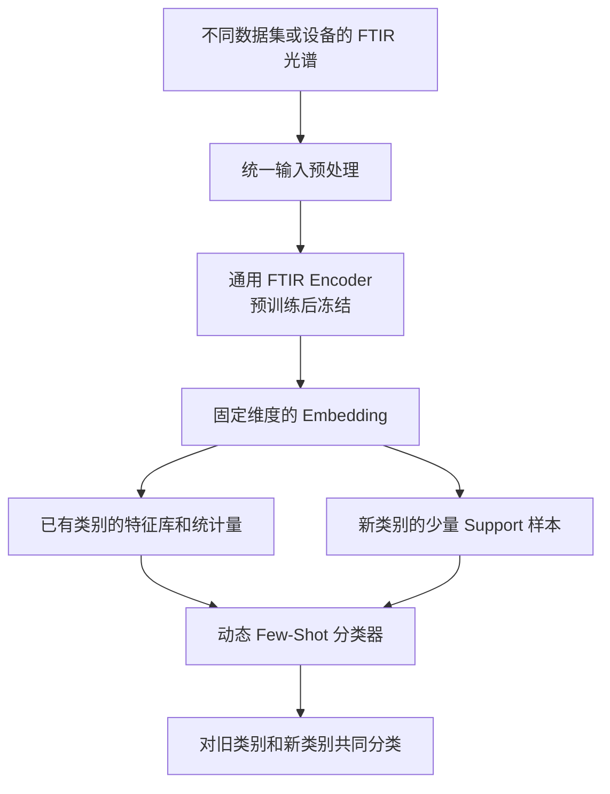

# 可复用 FTIR Encoder 与持续 Few-Shot 分类研究方案

> 研究方向：**Reusable Spectral Representation Learning for Few-Shot Class-Incremental FTIR Classification**  
> 中文：**面向少样本类别增量 FTIR 分类的可复用光谱表征学习**  
> 记录日期：2026-10-21

## 1. 核心研究目标

本研究的目标不仅是提高 FTIR Few-Shot 分类的 Accuracy，更重要的是建立一个**模型可复用、输入统一、支持持续增加类别、无需反复训练 Encoder** 的分类系统。

核心设想如下：

1. **统一输入**：来自不同数据集、批次和设备的 FTIR 光谱，通过波数轴对齐、归一化和统一预处理，进入同一个模型。
2. **可复用 Encoder**：预训练一个轻量的通用 FTIR Encoder，在部署后尽可能冻结参数并长期复用。
3. **少样本新类别适应**：出现新类别时，只需提供少量带标签光谱，例如每类 1、5、10 或 20 条，即可建立新类别表示。
4. **持续类别扩展**：添加新类别时，保留已有类别的识别能力，避免每次从头训练深度网络。
5. **可验证的泛化**：在未参与 Encoder 训练的类别、数据集、批次或设备上评估性能。

这一研究方向更接近 **Few-Shot Class-Incremental Learning（少样本类别增量学习）**，而不是单次、固定类别的 Few-Shot Classification。

## 2. 整体系统架构

系统的关键在于：初始阶段学习可迁移的光谱表示，后续新类别到来时**不修改 Encoder 参数**，而是在特征空间中更新类别原型、特征库或必要的统计量。

## 3. SVM 与 Encoder 的关系

现有实验表明，**原始 FTIR 光谱上的 SVM 是很强的基线**。这并不意味着 Encoder 没有价值，而是提示我们需要区分：

- **表征问题**：Encoder 是否丢失了原始光谱中对分类有用的信息？
- **分类决策问题**：Encoder 已学习到有效特征，但当前 Prototype / Mahalanobis 分类决策是否不足？

定义共享特征提取器：

\[
z=f_{\theta}(x),\qquad z\in\mathbb{R}^{d}
\]

其中 \(x\) 为统一预处理后的光谱，\(z\) 为固定维度的 Embedding。

| 模型 | Encoder 训练 | 增加新类别时的操作 |
|---|---|---|
| 原始 FTIR + SVM | 不需要 | 通常重新拟合 SVM |
| Encoder + SVM | 预训练后冻结 | 只重新拟合 SVM |
| Encoder + Prototype | 预训练后冻结 | 更新类别原型 |
| Encoder + Adaptive Mahalanobis | 预训练后冻结 | 更新原型和所需的统计量 |

**重要区别：不重新训练 Encoder，不等于分类器完全不需要重新拟合。**

如果希望新类别加入后能够立即用于分类，且整个流程不需要优化参数，那么 Prototype、Nearest Neighbour 或基于特征库的分类方式通常比 SVM 更符合这一目标。SVM 可以继续作为性能基线，也可以作为可选的轻量级分类头。

## 4. 可复用 Encoder 的训练方案

建议将研究拆分为两个阶段，避免把重点局限于调整 Mahalanobis 距离。

### 4.1 第一阶段：学习通用 FTIR 表征

候选架构可采用轻量级 **Multi-scale 1D CNN Encoder**，例如把一条光谱映射到 128 维 Embedding。网络类型与维度均需要通过验证集实验确定。

可以探索以下训练目标：

| 训练目标 | 希望解决的问题 |
|---|---|
| Self-Supervised Learning | 利用无标签光谱学习可迁移的光谱结构 |
| Supervised Contrastive Learning | 改善不同类别的特征区分度 |
| Episodic Few-Shot Training | 模拟未来仅有少量新类别样本的任务 |

一个待验证的联合目标为：

\[
\mathcal{L}=
\lambda_{1}\mathcal{L}_{\mathrm{contrast}}
+\lambda_{2}\mathcal{L}_{\mathrm{episode}}
+\lambda_{3}\mathcal{L}_{\mathrm{reconstruction}}
\]

这个目标函数目前仅是**候选方案**。三个损失是否互补、重建项是否必要，以及各个权重如何设置，都需要消融实验判断。

### 4.2 第二阶段：冻结 Encoder，支持持续分类

训练结束后，冻结 Encoder 参数：

\[
\theta^{(t+1)}=\theta^{(t)}
\]

对于新类别 \(c\)，仅用 \(K\) 个带标签 Support 样本计算 Prototype：

\[
\mu_c=\frac{1}{K}\sum_{i=1}^{K}f_{\theta}(x_i)
\]

后续可以根据新类别的数据数量更新原型或其他统计量，而不需要重新训练 Encoder。

**特别注意 1-shot：** 每类只有一个 Support 样本时，无法可靠估计该类别独立的协方差。因此，Adaptive Mahalanobis 更适合采用**共享度量与类别自适应度量之间的平滑过渡**：低 shot 时更多依赖共享统计量，样本增加后再逐渐提高类别统计量的权重。

这样，当前已开发的 Adaptive Mahalanobis 可以被重新定位为固定 Encoder 后的增量分类组件，而不是独立追求比 SVM 更高的单次分类准确率。

## 5. 必须增加的诊断实验

在重新设计 Encoder 之前，应先用**当前已经训练好的 Encoder** 检查问题的来源。

| 特征输入 | 分类器 | 实验目的 |
|---|---|---|
| 原始 FTIR | SVM | 最强现有基线 |
| PCA 降维 FTIR | SVM | 检验主要判别信息是否可由低维线性表示保留 |
| 冻结的 Encoder Embedding | SVM | 判断学习到的特征是否具有判别能力 |
| 冻结的 Encoder Embedding | Adaptive Mahalanobis | 当前方法的对照 |

在 **C4、C8** 的 **1、5、10、20-shot** 条件下执行相同 Support / Query 划分，并沿用一致的随机 seed、数据预处理和评估协议。任何归一化统计量、PCA 或超参数选择都不能使用测试 Query 标签或引入不允许的测试信息。

### 5.1 根据结果选择下一步

| 诊断结果 | 主要判断 | 后续方向 |
|---|---|---|
| Encoder + SVM 超过原始 SVM | Encoder 可能获得有价值的光谱表示 | 保留 Encoder，重点研究持续分类 |
| Encoder + SVM 接近原始 SVM | 现有表示可能已具备足够判别力 | 重点检验复用、泛化和类别扩展 |
| Encoder + SVM 明显低于原始 SVM | Encoder 可能丢失重要判别信息 | 优先检查特征学习和训练目标 |
| Encoder + SVM 很强，但 Mahalanobis 明显较弱 | 分类决策可能是瓶颈 | 优化冻结特征上的增量分类机制 |

## 6. 证明泛化与可持续性的实验设计

仅比较一次性 1、5、10、20-shot Accuracy，不足以证明模型能够长期复用。建议增加以下实验。

### 6.1 类别增量实验（Class-Incremental Evaluation）

设计多个连续 Session：

- **Base Session**：使用基础类别训练 Encoder，随后冻结参数。
- **Session 1**：加入第一批新类别，每个新类别提供少量标记样本，例如 5-shot。
- **Session 2**：继续加入另一批新类别，Encoder 仍然冻结。
- **后续 Session**：重复类别扩展，测量累计性能变化。

每个 Session 都需要测试**截至该 Session 已出现的所有类别**，不能只报告新增类别的结果。

主要问题包括：

1. 新类别仅提供 5 条光谱时，是否能够识别？
2. 新增类别后，旧类别 Accuracy 是否下降？
3. 随着类别数量增长，整体 Accuracy、旧类 Accuracy、新类 Accuracy 如何变化？
4. 新增类别时，是否确实无需重新训练 Encoder？模型更新成本有多低？

### 6.2 跨数据集、批次或设备泛化

在条件允许时，使用独立 FTIR 数据评估冻结 Encoder 的迁移能力。

需要区分两种情况：

- **未见过的新类别**：评估模型对类别变化的适应能力。
- **未见过的数据域**：评估不同仪器、批次、制样流程或采样条件带来的分布变化。

如果 C4 与 C8 只是同一数据集的不同类别子集，它们不能单独证明跨数据集或跨设备泛化。训练、验证及最终测试必须有清晰的数据隔离协议。

### 6.3 持续使用中的边界

冻结 Encoder 不意味着模型可以无限期适应任何新数据。若出现显著的测量设备变化、样本体系变化或化学分布漂移，仍可能需要域校准或升级 Encoder。

因此，“可持续性”应定义为**在规定的任务范围与数据分布变化下，能够保持较长时间复用并低成本扩展类别**，而非永久不训练。

## 7. 如何看待当前 SVM 优势

原始谱 SVM 的准确率明显更高，提示原始 FTIR 特征可能已经具有较强的判别结构。当前模型不应仅通过继续微调协方差估计来追赶 SVM。

即使某个冻结 Encoder + Prototype 方法的准确率略低于 SVM，只要能可靠证明以下能力，仍可能形成有意义的论文贡献：

- 新类别只需极少标记光谱即可上线。
- 新增类别无需重新训练深度 Encoder。
- 已有类别的性能得到合理保留。
- 在明确界定的跨域任务中具备稳定泛化。
- 推理、模型更新、存储和维护成本更低。

**不过，上述优势都必须用实验指标量化，不能只根据架构设计作出声明。**

## 8. 建议的论文定位与潜在贡献

**候选英文题目：**

*Reusable Spectral Representation Learning for Few-Shot Class-Incremental FTIR Classification*

**候选中文题目：**

*面向少样本类别增量 FTIR 分类的可复用光谱表征学习*

可围绕三个主要贡献组织论文：

1. **统一的光谱输入与表征框架**：支持明确范围内的不同 FTIR 数据，学习固定维度的共享特征。
2. **可冻结、可迁移的 Encoder**：重点研究新类别与新数据域下的少样本泛化，而不是只优化固定类别 Accuracy。
3. **轻量的类别增量适应机制**：使用 Prototype 或经过改进的 Adaptive Mahalanobis，支持在不重新训练 Encoder 的情况下扩展类别。

必须注意：**冻结 Encoder 并添加 Prototype 本身不是充分的新颖性贡献。** 真正的创新需要来自 FTIR 领域特性、可迁移表征、低 shot 自适应机制、跨域泛化或者严谨而独特的增量实验发现。

## 9. 下一步优先执行的任务

**第一优先级：使用当前 Encoder 进行冻结特征诊断，不立即重新训练网络。**

建议执行顺序：

1. 载入已经训练好的 Encoder 并冻结参数。
2. 导出相同 C4/C8、相同 seed 和相同划分下的 Support/Query Embedding。
3. 在 Embedding 上拟合并评估 SVM，和现有 Adaptive Mahalanobis、原始谱 SVM 对比。
4. 增加 PCA + SVM 对照，定位原始判别信息是否在特征映射中损失。
5. 根据诊断结果决定是否需要重构 Encoder 的训练目标。
6. 再设计正式的 Base / Incremental Session 实验，验证新类别适应、旧类别保留与复用成本。

## 10. 总结

研究重点应从：

> 如何继续优化 Mahalanobis 距离，单纯超过原始光谱 SVM？

调整为：

> **如何训练一个真正可迁移、长期可复用的 FTIR Encoder，并实现只增加少量标记光谱即可持续扩展新类别？**

Adaptive Mahalanobis 不必立即放弃，但应围绕上述总体目标重新定位。当前最有价值的一步是**冻结现有 Encoder + SVM 的诊断实验**，先识别瓶颈，再投入新的算法设计。
